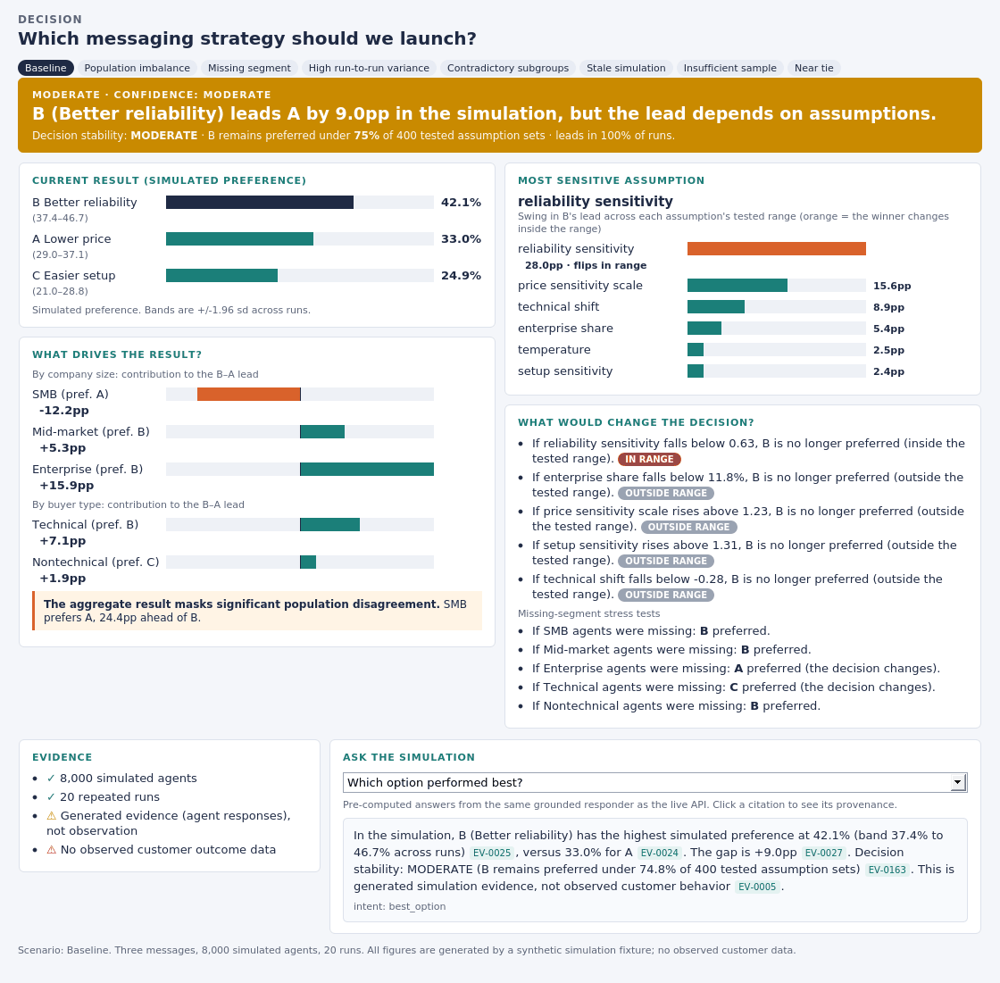
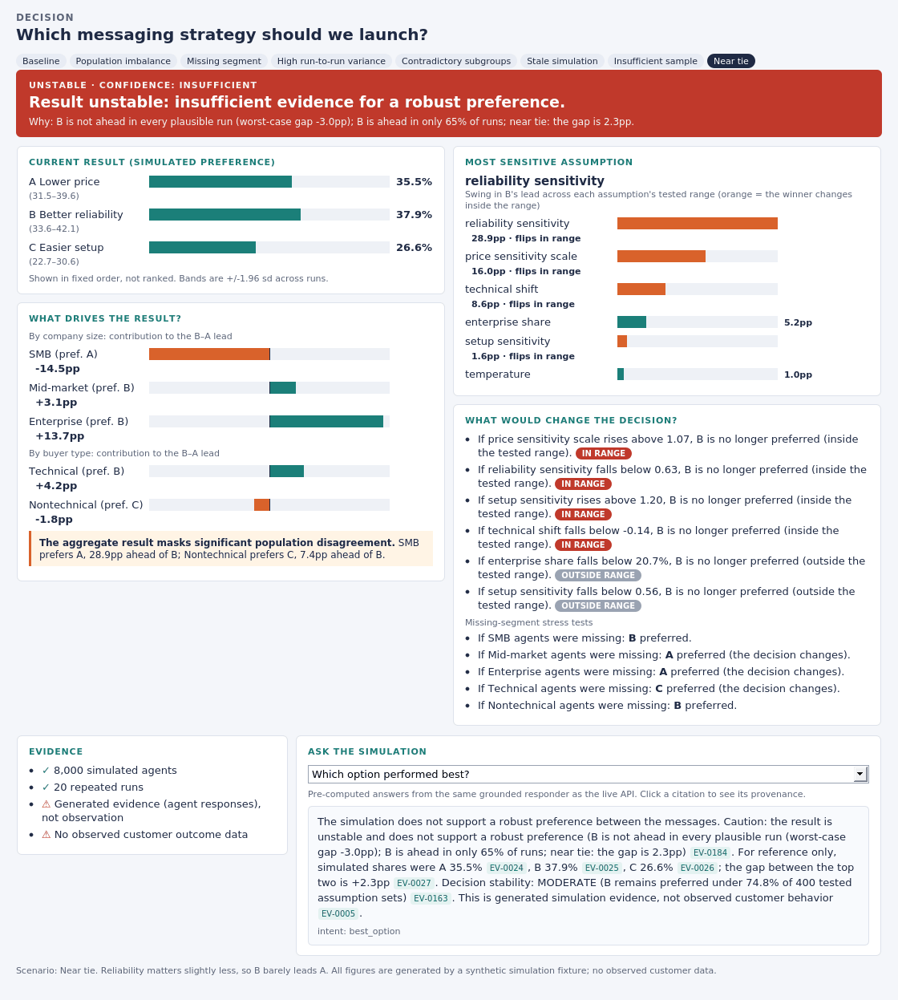

# DecisionTrace

**An evidence and uncertainty layer for AI simulations.**

A simulation says *"Option B is likely to outperform Option A."* A decision-maker's next questions are: **Why? How certain? Which populations drove it? What does it depend on? What would flip it?**
DecisionTrace is the layer that answers those, and that **changes what it says** when the evidence is too weak to support a confident headline.

**[Read the 4-page note: When should you trust a simulated decision?](note/DecisionTrace_note.pdf)** (the argument). This README is the technical substantiation.

<p align="center"></p>

▶ Open [`demo/decision_screen.html`](demo/decision_screen.html) in a browser (self-contained, no server, switch between 8 scenarios) · or run the live app (below).

> **Scope.** The simulation is a *test fixture*, not a model of real buyers. 8,000 synthetic agents choose among three hypothetical messages
> (**A** lower price, **B** better reliability, **C** easier setup). The engineering starts after the simulation produces results.
> Everything is synthetic; no real customer data; no claim that the population predicts real humans.

## Architecture: the LLM never computes a result

```
simulation fixture ──► evidence ledger (SQLite) ──► deterministic analysis ──► decision screen
 (engine.py)            INPUT / GENERATED /          segments, stability,       (ui.py, FastAPI)
                        DERIVED / OBSERVED           flip thresholds,                │
                        + provenance chains          presentation policy             ▼
                                                                          follow-up questions
                                                                          (ask.py: grounded; LLM may only
                                                                           *phrase*, and is rejected by the
                                                                           same checks the harness uses)
```

Deterministic code computes preference rates, segment effects, uncertainty, sensitivity, flip thresholds and provenance. The interrogation layer sees **only** ledger rows.

## What the base case says (seed 42; all numbers generated by the code)

| | |
|---|---|
| **Result** | B 42.1% (band 37.4–46.7), A 33.0%, C 24.9%: **B leads A by 9.0pp** in the simulation |
| **Stability** | **MODERATE**: B stays preferred under 74.8% of 400 tested assumption sets; B leads in 100% of 20 runs |
| **What drives it** | Enterprise **+15.9pp**, Mid-market +5.3pp, **SMB −12.2pp** (SMB prefers A). Technical +7.1pp; Nontechnical's top choice is C |
| **Aggregate masks disagreement** | yes: SMB (50% of the population) prefers A, 24.4pp ahead of B (47.3% vs 22.9%) |
| **Most sensitive assumption** | **reliability sensitivity**: moves B's lead by 28pp across its tested range; B stops being preferred below **0.63** (*inside* the tested range) |
| **Other flips** | enterprise share < 11.8% (nominal 25%, outside the tested ±15%); price sensitivity > 1.23; with Enterprise agents missing, A is preferred |
| **Evidence** | 184 ledger rows; 8,000 agents, 20 runs; generated evidence only; **no observed customer data** |

The decision rests mostly on an *unvalidated simulation input* (how much reliability matters), not on population mix. That is the kind of thing a headline number hides.

## It changes what it says when the evidence is weak

Same pipeline, seven controlled degradations of the baseline. The naive headline lead barely moves in several; the presentation does:

| Scenario | What was broken | Presentation state | Headline |
|---|---|---|---|
| Baseline | n/a | **MODERATE** | B leads A by 9.0pp, but the lead depends on assumptions |
| Population imbalance | Enterprise weighted to 25% of the result from 169 agents | **INSUFFICIENT EVIDENCE** | …Enterprise is 25% of the weighted result but only 169 agents |
| Missing segment | No Enterprise agents | **INSUFFICIENT EVIDENCE** | …no Enterprise agents in the population (A would win) |
| High run-to-run variance | Simulator noise ×11 | **UNSTABLE** | Result unstable: insufficient evidence for a robust preference |
| Contradictory subgroups | SMB majority prefers A strongly | **CONTESTED** | …the aggregate masks strong segment disagreement |
| Stale simulation | Run on input v1, current is v2 | **OUT OF DATE** | …re-run before using |
| Insufficient sample | 300 agents | **INSUFFICIENT EVIDENCE** | only 300 simulated agents (minimum 1,000) |
| Near tie | B leads by 2.3pp | **UNSTABLE** | Result unstable (B ahead in only 65% of runs) |

<p align="center"></p>

Weak-evidence states never claim a leader, show options unranked, and set confidence to *Insufficient*. This is tested (`test_weak_evidence_states_never_claim_a_leader`).

## Follow-up interrogation, with provenance

The responder answers only from ledger rows, cites every number (`[EV-0025]`, click to see its provenance chain back to `INPUT`), phrases "why" as *association between modeled attributes and simulated choices, not an established cause*, corrects false premises ("Why did SMB buyers prefer B?" → they did not), and refuses what the evidence cannot support:

> **Did real customers prefer B?** The simulation does not establish that. Every preference figure here is generated by simulated agents, and no observed customer outcome data was supplied [EV-0005]. …
> **What will B do to revenue next year?** That is not supported by the evidence in this ledger [EV-0003]. The simulation only measures simulated message preference…

Evidence classes: `INPUT` (configuration), `GENERATED` (simulated agent responses), `DERIVED` (deterministic computation), `OBSERVED` (real outcomes; **none exist**, and the ledger records that absence explicitly).

## Evaluation harness (51 questions × 8 scenarios = 408 answers)

Scored on: **citation accuracy**, **numerical fidelity**, **observed vs generated**, **uncertainty preserved**, and **`EVIDENCE_OVERREACH`** (unsupported causal story, unsupported question answered, false premise accepted, empirical or certainty claims).

| | citation | numeric | observed | uncertainty | overreach | all five |
|---|---|---|---|---|---|---|
| Grounded responder (408 answers) | 100% | 100% | 100% | 100% | 100% | **100%** |
| Scripted ungrounded baseline (51) | 0% | 67%* | 8% | 18% | 4% | **0%** |

\*vacuous: most baseline answers contain no numbers to check.

**Read these carefully:**
- The grounded responder and the checkers were built together, so 100% is a consistency result, not a generalization claim. The harness did earn its keep: it caught five real bugs in my own responder while I built it (misrouted question, missing cautions in weak-evidence branches, uncited numbers).
- The baseline is a **scripted** strawman, not an LLM. It shows the checkers discriminate; it is not a measurement of any model.
- Mutation testing (inject one defect into an answer): **all 2,698 mutants caught, 0 of 408 clean answers flagged.** But the mutations use the phrases the checkers were written for. On **7 hand-written subtle overreach answers the lexicons were not tuned on, only 1 was caught (0 of 6 clean paraphrases flagged).** The checkers have high precision and low recall on novel phrasing. A production version needs an LLM judge plus human audit.
- No LLM was called anywhere in this repo. `ask.llm_answer` is an adapter whose output is rejected unless it passes the same checks (tested with a fake client that returns invented evidence).

## Limitations and deviations (so nothing here is oversold)

- The fixture's utility parameters were found by random search to give a segment structure (SMB→A, Enterprise→B, Technical→B, Nontechnical→C) and a moderately fragile base case. That is a legitimate way to build a test fixture, but the specific numbers (9.0pp, 74.8%) are artifacts of it.
- Stability is defined over *my* tested ranges (±20% on sensitivities, ±15% on enterprise share). A different range gives a different number; the ranges are in `config.py` and are listed as assumptions in the ledger.
- "Observed evidence → experiment configuration" in the original framing is called `INPUT` here; `OBSERVED` is reserved for real-world outcome data.
- SQLite rather than Postgres, and server-rendered HTML with a few lines of plain JavaScript rather than React/TypeScript, to keep it runnable with `pip install` alone.
- The causal/mechanism and certainty checkers are lexicon-based heuristics (see above).

## Run it

```bash
pip install -r requirements.txt
python scripts/run_all.py                     # results/, figures/, demo/decision_screen.html (~40s)
uvicorn decisiontrace.api:app --reload        # live app at http://localhost:8000  (?scenario=near_tie, ...)
pytest -q                                     # 35 tests (~45s)
# the PDF note is committed; rebuilding it needs reportlab, pypdf and the Carlito font:  python note/build_note.py
```

API: `GET /api/scenarios` · `GET /api/decision/{scenario}` · `GET /api/evidence/{scenario}/{id}` (with provenance chain) · `POST /api/ask {scenario, question}` (grounded answer + citations + guardrail results)

## Layout

```
decisiontrace/  config · engine (fixture) · ledger · analysis (stability, flips, decision policy) · scenarios
                ask (grounded responder + LLM adapter) · evalharness · ui · api
scripts/        run_all.py (metrics, figures, screenshots) · export_demo.py
note/           DecisionTrace_note.pdf (4-page note) · build_note.py (every number is read from the experiment)
tests/          ledger integrity, flip correctness, scenario states, guardrails, harness validity, API
results/ figures/ demo/
```
